# bobo

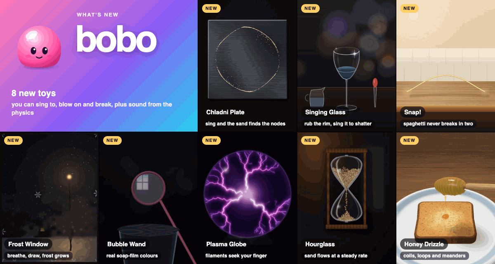

A physics sandbox of 26 small toys built on novel, satisfying, performant simulations (liquid, particles, cloth, yarn, soft bodies, sand, dirt, molten metal, paper and film), tuned for juicy visuals and sound. It runs in the browser and as an iOS and Android app.

## Toys

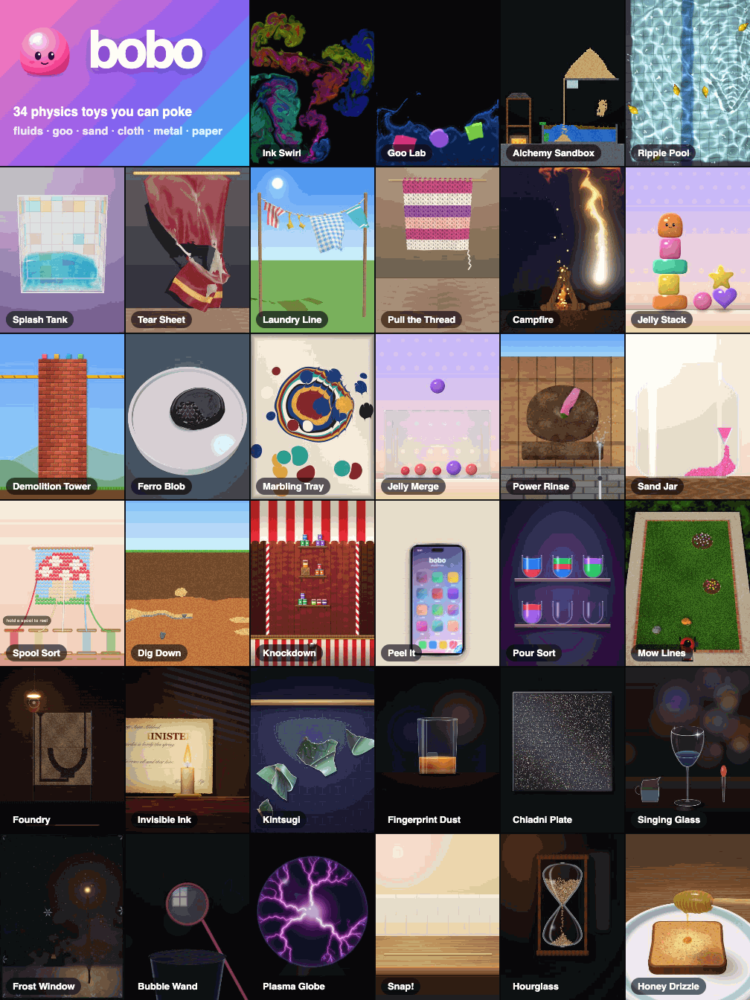

Grouped by the hub's shelves.

| Toy | What it is | Tech |
|---|---|---|
| **Ink Swirl** | Finger-paint glowing fluid; tap to burst, flick to swirl. *Paint* mode mixes colours like real pigment. | Stable Fluids on WebGL2 (`src/toys/ink`) |
| **Ripple Pool** | Poke a sunlit pool, watch caustics dance, grab and fling rubber ducks, make it rain. | Height-field waves + mesh caustics on WebGL2 (`src/toys/pool`) |
| **Splash Tank** | A glass tank of 3D water: tilt the phone (or drag) to slosh it, poke it, drop beach balls, make a big splash. | 3D MLS-MPM + screen-space fluid rendering on WebGPU (`src/toys/splash`) |
| **Campfire** | Stack logs, strike a match, blow on the embers; fire climbs the wood, chars it, and hisses when doused. An oxygen field feeds it: drop a glass jar over the flames and they choke to embers, then lift it for a whoosh of flame. | Stable-fluids fire (heat, smoke, buoyancy) + CPU burning and oxygen cells on WebGL2 (`src/toys/fire`) |
| **Ferro Blob** | Drag a magnet under a dish of black ferrofluid: it crawls after you and bristles with spikes; two fingers split it, taps drop droplets. | Double-density particle liquid + Rosensweig spike lattice + chrome shading on WebGL2 (`src/toys/ferro`) |
| **Pour Sort** | Liquid sort with real pouring: tap a tube, tap another, and a cohesive stream pours across. Liquids have densities, so oil floats up through syrup after a pour. Every level is solver-checked; undo any time. | Layer-stack logic + Clavet double-density particle stream on WebGL2 (`src/toys/pour`) |
| **Goo Lab** | Pour water, jelly, snow and sand that all interact; poke and squish them. Snow and sand glitter as grains tumble. | 2D MLS-MPM on WebGPU compute, per-grain glints (`src/toys/goo`) |
| **Jelly Stack** | Tap to drop gummy cubes, stars, hearts and a smiling Bobo; stack them, grab and fling, slap the tower over. | Shape-matching soft bodies + PBD contacts on WebGL2 (`src/toys/jelly`) |
| **Jelly Merge** | Suika with gummies: drop jelly fruit into a jar; matching sizes smoosh together and pop into a bigger one (hit-stop, shockwave, combo pitch), all the way to a giant Bobo. | Jelly Stack's shape matching + merge rules on WebGL2 (`src/toys/merge`) |
| **Tear Sheet** | Pull a velvet curtain until it rips, slash it with a swipe, throw balls into a flag or a hammock. | XPBD cloth on CPU + WebGL2 (`src/toys/cloth`) |
| **Laundry Line** | Washing pegged to a sagging line: swipe for gusts, hold for a storm; pegs pop and laundry blows away. | XPBD cloth + rope on CPU + WebGL2 (`src/toys/laundry`) |
| **Pull the Thread** | Grab the loose end of a chunky knit and unravel it stitch by stitch, row by row, into a pile of crinkly yarn. | Stitch grid over XPBD cloth + XPBD yarn strand on WebGL2 (`src/toys/thread`) |
| **Spool Sort** | Tap a spool and it reels its colour out of a knitted picture from the bottom up; stitches tug and sag, and anything cut loose drops away. | Mass-spring knit + verlet yarn on Canvas 2D (`src/toys/spool`) |
| **Alchemy Sandbox** | Falling-sand chemistry: fire, water, lava, acid, plants, ice, gunpowder and more react with each other. | Cellular automaton on CPU + WebGL2 glow (`src/toys/sand`) |
| **Dig Down** | Scoop down through a backyard: soil holds until you undercut it, then caves in; clay holds tunnels, sand runs, water pockets drain, rock needs chipping. Dig up 12 buried finds for your shelf. | Falling-sand CA with span-based cohesion on Canvas 2D (`src/toys/dig`) |
| **Demolition Tower** | Swing a wrecking ball, drop bombs or flick cannonballs into brick towers, pyramids and castles; blocks shatter into debris and dust. Rubble has rolling resistance and settles, and tall stacks stand still. | Pure-TS 2D rigid bodies (Box2D v3-style soft step, rolling resistance, shock propagation, island waking) + WebGL2 (`src/toys/demolition`) |
| **Knockdown** | A fairground stall of tin cans, glass jars and wooden crates. Drag back the slingshot, watch the arc, and clear the shelves: glass shatters and splats jam, crates splinter, the last item gets slow-mo. | Demolition's rigid bodies with per-material bounce, baked Voronoi shatter and jam decals on WebGL2 (`src/toys/knockdown`) |
| **Marbling Tray** | Drop inks on a bath, drag combs, rakes and a stylus into feathered ebru patterns, then lay paper to keep a print. | Mixwell analytic marbling brushes (SIGGRAPH 2026 Best Paper) on WebGL2 (`src/toys/marble`) |
| **Power Rinse** | Blast a mud-caked Bobo statue, duck, gnome or mosaic clean; a "% clean" ring fills and hidden details appear. | Erodible mud and moss layers, runoff and spray on WebGL2 (`src/toys/rinse`) |
| **Sand Jar** | Pour coloured sand through a funnel into a bottle, poke scallops, tilt the strata; or pour matching colours to reveal a hidden picture. | Sand-only falling-sand CA with picture targets on WebGL2 (`src/toys/sandjar`) |
| **Peel It** | Peel a screen protector, a sticker, masking tape or a gadget's film. Roll it back slowly and it comes off clean; yank it and it tears, leaving a scrap to pick at. | XPBD film with per-vertex glue that lets go by the Kendall peel relation, on WebGL2 (`src/toys/peel`) |
| **Mow Lines** | Mow a lawn into stripes: each pass leans the stubble your way, so neighbouring passes read light and dark. The motor bogs down in long grass; mind the flower beds, the stone and the cat. | Shell-texture grass with CPU length and lean maps on WebGL2 (`src/toys/mow`) |
| **Foundry** | Pour glowing bronze into a sand mould, let it cool, smash the mould open, and ring what you cast. A steady pour rings true; a hesitant one leaves cold shuts and clunks. | Falling-sand CA with a hot, cooling metal cell and glow on Canvas 2D (`src/toys/foundry`) |
| **Invisible Ink** | Hold a secret letter over a candle to bring out the hidden message, but keep it moving: the paper browns, chars and catches, and what burns is lost. | Heat, char and fire grid over a hidden-ink mask on WebGL2 (`src/toys/ink-letter`) |
| **Kintsugi** | Drop a porcelain bowl, fit the shards back with a magnetic click, and pour gold that races along every crack. Mended pieces go on a shelf. | Voronoi fracture with shared seam lines, a 1D gold flow over the seam network, Canvas 2D (`src/toys/kintsugi`) |
| **Fingerprint Dust** | Brush powder until hidden prints bloom, blow away the excess, lift the print with tape, and match it to a suspect's card. | Powder grains on a ridge-adhesion mask, Peel It's film for the tape, WebGL2 (`src/toys/prints`) |

## The menu

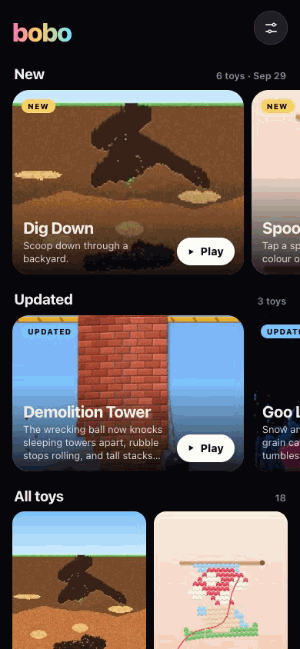

The hub shows each toy as a live preview card. **New** and **Updated** rows sit at the top, and updated toys say what changed right on the card; a yellow or blue dot marks them in the grid. Tap a toy for its sheet: description, a dated **What's new** list, papers and Play. Swipe the sheet down to dismiss it. Sort by newest, A–Z or shelf; previews can be set to Auto, Wi-Fi only or Off. Updates are logged in [`src/shell/catalog.ts`](src/shell/catalog.ts).

Inside a toy there's a **Tune** panel (top right) with live sliders and a **Based on** list linking the papers and reference code it uses. There's also a **Clip** button that records 8 s to share, a sound toggle, and an FPS readout (top centre).

<br clear="right">

## Sound

Every toy has procedural sound: [`src/shell/sound.ts`](src/shell/sound.ts) synthesises 14 one-shot voices (pop, squish, boing, thud, knock, tick, snap, rip, splash, whoosh, crumble, sizzle, chime, plop) and 5 filtered loops (hiss, rumble, trickle, crackle, bubble) with Web Audio, so there are no audio files. Toys drive pitch, loudness and stereo position from the physics, such as impact strength, body size, pour rate or stir speed. Haptics fire alongside on iOS and Android.

## Haptics

Taps and hits use `ctx.haptic()`. For feel that runs *with* the action, toys call `ctx.hapticLevel(intensity, sharpness)` every frame; skipping a frame stops it. Power Rinse's jet, Mow Lines' motor bogging down, Peel It's glue letting go, Pour Sort's stream, Spool Sort's reeling, Dig Down's scraping and cave-ins, Foundry's pour and Tear Sheet's strain all use it. [`src/shell/haptics.ts`](src/shell/haptics.ts) sends the level (up to 30 times a second) to a small native plugin that picks the best the phone can do:

| Platform | How |
|---|---|
| iOS | One looping Core Haptics player with live intensity and sharpness (`BoboHapticsPlugin` in `ios/App/App/SceneDelegate.swift`) |
| Android 16+ with envelope support | Short intensity/sharpness envelopes, re-sent before each ends, each ramping from the last level (`BoboHapticsPlugin.java`) |
| Android with amplitude control | A looping waveform at the current amplitude; sharp settings become a fast pulse train. The Galaxy S24 lands here: Android 16, but its motor reports no envelope support |
| Browser | `navigator.vibrate` pulses whose rate follows the intensity |

The app logs its tier at start (`[bobo] haptics: core-haptics`).

## Microphone

Toys can listen for breath and song. A toy calls `ctx.mic.offer(hint)` and a mic button appears in its HUD; nothing listens until the player taps it, and it stops when the toy closes or the app goes to the background. [`src/shell/mic.ts`](src/shell/mic.ts) turns three raw features — loudness, pitch, and how periodic the sound is (a normalised autocorrelation peak) — into `ctx.mic.blow` (loud and unvoiced: breath is turbulent noise), `ctx.mic.level` and `ctx.mic.pitch` (only for a clear note). The features come from a native `BoboMic` plugin (an `AVAudioEngine` tap on iOS, where the web view's audio input reads silence; `AudioRecord` on Android) or from `getUserMedia` in a browser. Audio is analysed on the device and never recorded or sent. Campfire (blow to feed the fire) and Fingerprint Dust (blow the powder away) use it so far.

Play it: https://bobo-ashy-ten.vercel.app. Deploys are manual for now: `npx vercel deploy --prod --archive=tgz` (auto-deploy stopped when the repo moved to ai-asylum).

## Gallery

| | | | |
|:-:|:-:|:-:|:-:|
| 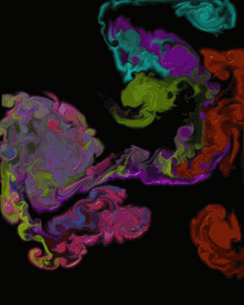<br>**Ink Swirl** | 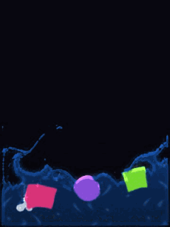<br>**Goo Lab** | 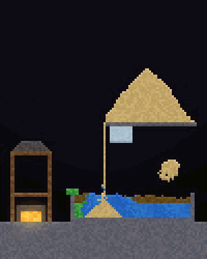<br>**Alchemy Sandbox** | 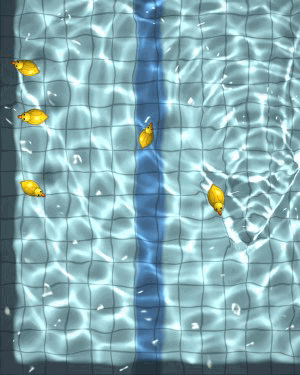<br>**Ripple Pool** |
| 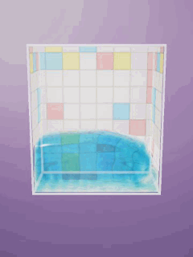<br>**Splash Tank** | 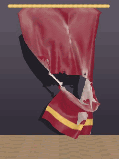<br>**Tear Sheet** | 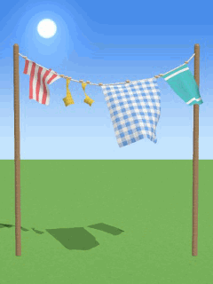<br>**Laundry Line** | 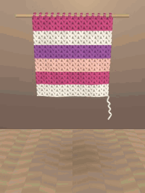<br>**Pull the Thread** |
| 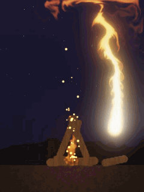<br>**Campfire** | 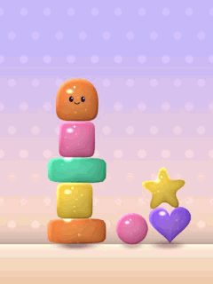<br>**Jelly Stack** | 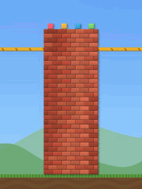<br>**Demolition Tower** | 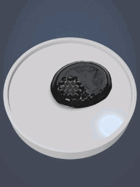<br>**Ferro Blob** |
| 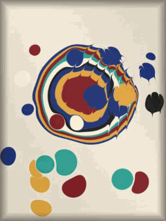<br>**Marbling Tray** | 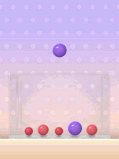<br>**Jelly Merge** | 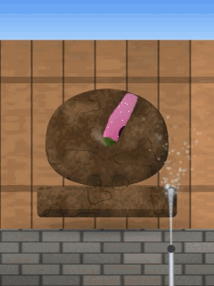<br>**Power Rinse** | 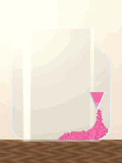<br>**Sand Jar** |
| 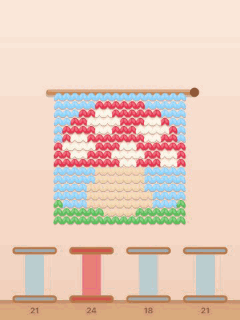<br>**Spool Sort** | 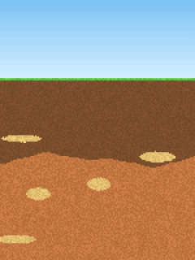<br>**Dig Down** | 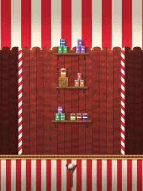<br>**Knockdown** | 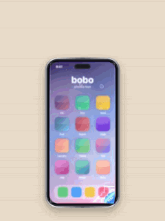<br>**Peel It** |
| 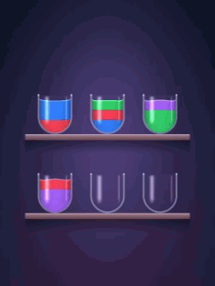<br>**Pour Sort** | 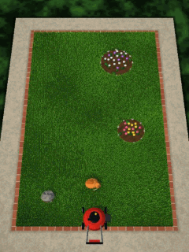<br>**Mow Lines** | 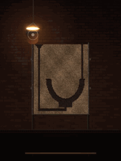<br>**Foundry** | 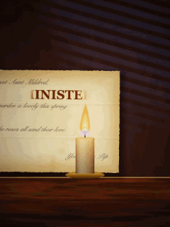<br>**Invisible Ink** |
| 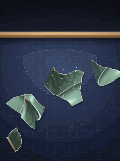<br>**Kintsugi** | 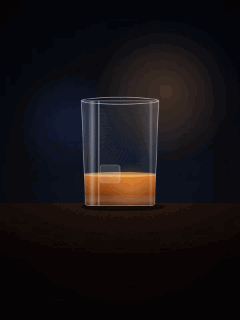<br>**Fingerprint Dust** |  |  |

Captured in headless Chrome with [`tools/media`](tools/media).

## Roadmap

Next up, from [docs/research/2026-directions.md](docs/research/2026-directions.md), [cloth-knitting.md](docs/research/cloth-knitting.md) and [shear-knit.md](docs/research/shear-knit.md):

| Next | What | Builds on |
|---|---|---|
| **Shear** | Clip the fleece off a sheep with shell fur and cut maps; the fleece peels off in one piece | Tear Sheet cutting, Laundry Line pins · [Lengyel et al. 2001](https://hhoppe.com/proj/fur/) |
| **Rope & yarn ball** | Ropes, chains and a yarn ball that unspools and tangles as a cat bats it | Pull the Thread's yarn · [Cosserat rods](https://animation.rwth-aachen.de/publication/0550/) |
| **Knit-a-Scarf** | Knit stitch by stitch from your own spun yarn, then dress the sheep | Pull the Thread's knit grid · [Stitch Meshes](https://www.cemyuksel.com/research/stitchmeshes/) |
| **Tablecloth Trick** | Yank a tablecloth out from under a dinner set | Tear Sheet cloth + Demolition's rigid bodies · [C-IPC](https://ipc-sim.github.io/C-IPC/) |

## Run

```sh
npm install
npm run dev        # http://localhost:5280, also on your LAN IP for phones on the same Wi-Fi
```

Goo Lab and Splash Tank need WebGPU: current Chrome/Edge, Safari 26+ (iOS/iPadOS/macOS 26). The other toys run anywhere with WebGL2.

## Android

With an Android device attached (USB debugging on), JDK 21 and the Android SDK installed:

```sh
npm run mobile:android:install   # build a debug APK, install and launch it
node mobile/android-soak.mjs goo 30   # launch a toy with the autoplay finger and print FPS from logcat
```

`ANDROID_SERIAL` picks a device when several are attached. The APK is written to `mobile/out/bobo-debug.apk`.

## iPhone

With an iPhone attached and trusted, and an Apple Development certificate in the keychain:

```sh
npm run mobile:ios:install   # build, sign, install and launch on the attached iPhone
npm run mobile:ios           # build only → mobile/out/ios/Build/Products/Debug-iphoneos/App.app
```

`IOS_TEAM_ID` overrides the signing team read from the certificate; `IOS_DEVICE` picks a device when several are attached. The app bundles the build, so no server is needed on the phone.

## Layout

```
src/main.ts            toy host: frame loop, FPS, resize, haptics, clip recorder, celebrate
src/shell/hub.ts       the hub: preview cards, New carousel, sort/shelf filter, toy sheets
src/shell/catalog.ts   when each toy shipped and which shelf it sits on
src/shell/sound.ts     procedural Web Audio voices and loops
src/shell/             also the Tune panel, multi-touch pointers, icons, shared styles, the Toy interface
src/toys/<toy>/        one folder per toy: export a `Toy` from index.ts and add a catalog.ts line; the hub finds it
src/previews/          3 s hub preview loops (.mp4 + .webp poster), made by tools/media
tools/media/           headless capture → hub previews, README GIFs and the cover
mobile/                Capacitor iOS and Android build, install and FPS soak scripts
```

## Docs

- [docs/research/2026-wave3.md](docs/research/2026-wave3.md) — the wave 3 refresh: SIGGRAPH 2026 simulation papers, the 2026 charts (Smash Fest, sort and chore games), scored candidates and build specs for Knockdown, Peel It, Pour Sort and Mow Lines
- [docs/research/2026-theme-toys.md](docs/research/2026-theme-toys.md) — theme-native toys from the theme-fit study (the theme *is* the physics): Foundry, Invisible Ink, Kintsugi and Fingerprint Dust
- [docs/research/2026-tech.md](docs/research/2026-tech.md), [2026-scene.md](docs/research/2026-scene.md), [2026-directions.md](docs/research/2026-directions.md) — autumn 2026 graphics/physics research, the games scene, and the toy picks they led to (waves 1 and 2)
- [docs/research/physics.md](docs/research/physics.md) — survey of real-time physics simulation techniques (Two Minute Papers, Ten Minute Physics, SIGGRAPH, etc.) and a backlog of sandbox toys to build
- [docs/research/cloth-knitting.md](docs/research/cloth-knitting.md) — cloth, yarn and knitting simulation: techniques, yarn-level research and how to fake it, browser playgrounds, and ten cloth/knit toy ideas (e.g. unravel a sweater)
- [docs/research/hub-design.md](docs/research/hub-design.md) — mobile catalog design (HIG / Material 3), preview video formats and playback budgets behind the hub
- [docs/research/shear-knit.md](docs/research/shear-knit.md) — a shear-the-sheep → spin → knit sandbox: touchscreen haptics and pseudo-haptics, Core Haptics bridge design, shell fur with cut maps, the one-piece fleece as a pinned cloth sheet, spinning twist physics, procedural audio, and a build plan
